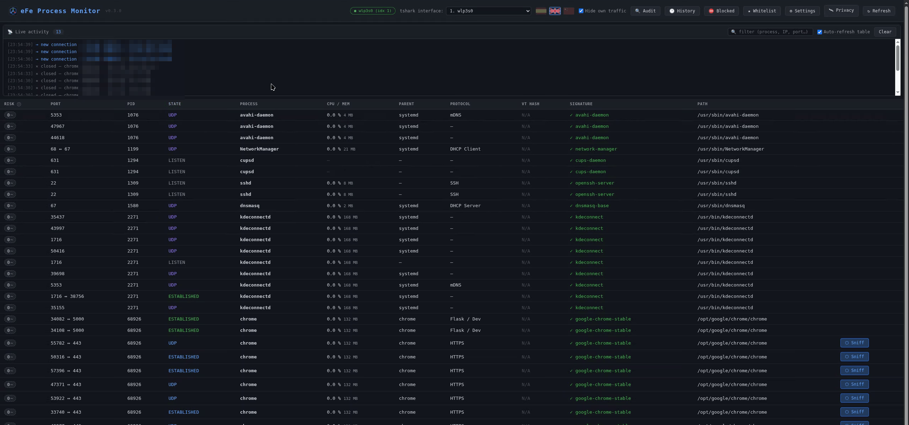
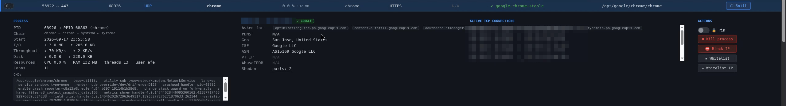
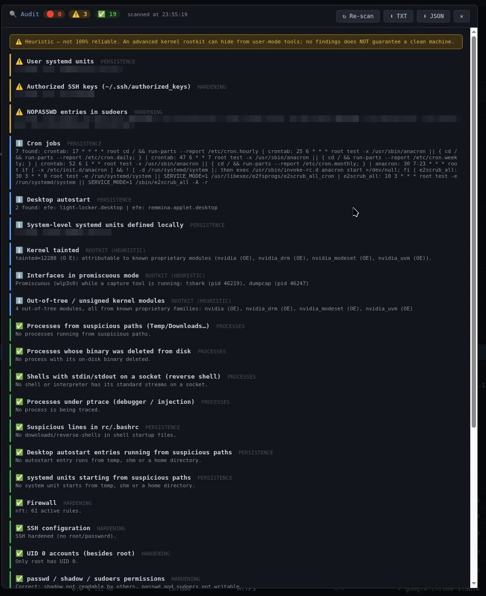
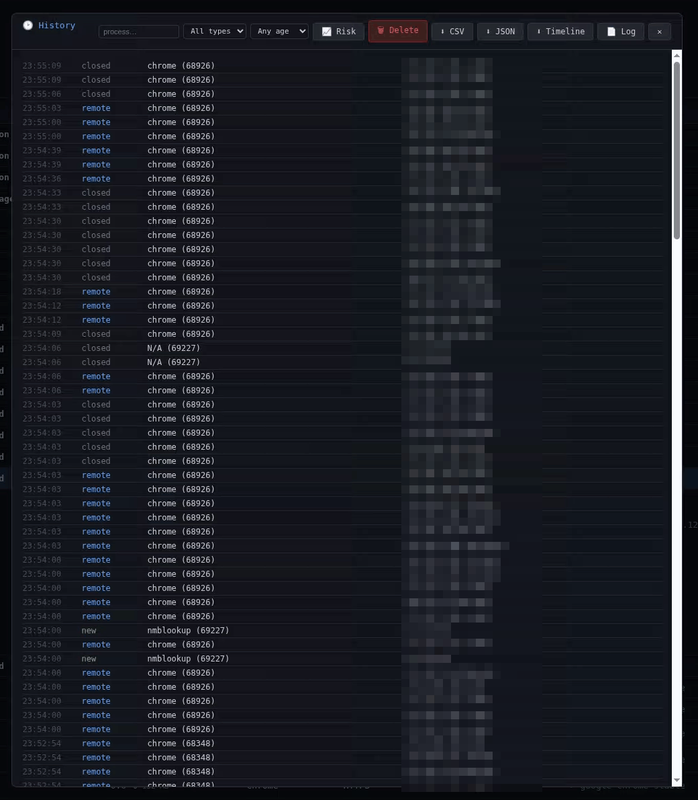
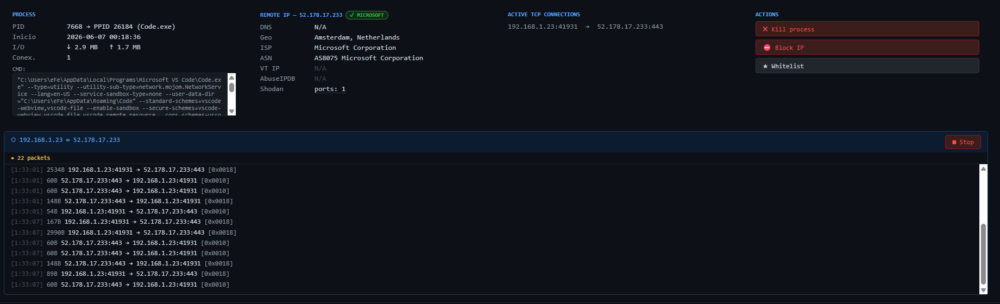

<div align="center">


# eFe Process Monitor

Monitor de procesos y red con un panel web local. Muestra a qué proceso pertenece
cada conexión, a dónde se conecta y qué dicen las fuentes de reputación/inteligencia
sobre el binario y la IP remota.


[English](README.md) · **Español**

</div>

> **Estado: estable.** Funciona y se usa a diario. La interfaz y los datos guardados pueden evolucionar entre versiones.

**Novedades de la 0.5.0** — el monitor ya puede **arrancar con el sistema en
Linux**: `sudo efemon --install-service` (o ⚙ Ajustes → *Arranque con el
sistema*) lo instala como servicio systemd en `/opt/efemon`; vigila antes de que
nadie inicie sesión, y el icono de bandeja, las notificaciones y *Abrir panel*
se enganchan a tu sesión cuando aparece. Nuevos flags `--version` y
`--no-browser`. Nueva fuente de reputación, **URLhaus** (abuse.ch, la misma
Auth-Key que ThreatFox), que señala direcciones que están distribuyendo malware
ahora mismo. Y el panel corre bajo una Content-Security-Policy estricta: sin
JavaScript inline en ninguna parte. Detalle completo en el [changelog](CHANGELOG.md).

<div align="center">

</div>

## Qué es

Un único binario autocontenido (sin instalación, sin dependencias, sin cgo) que
sirve un panel web en `127.0.0.1:5000`. Lista cada conexión TCP/UDP activa junto
con el proceso que hay detrás, y enriquece cada una con datos de reputación del
binario y de la IP. A grandes rasgos: `netstat`/TCPView, más consultas de
reputación, una captura de paquetes y una auditoría del equipo, en una sola
página local.

Es una herramienta **defensiva / forense** — para inspeccionar tu propia máquina,
no para atacar a otros.

## Características

**Conexiones y procesos**
- Cada conexión TCP/UDP con su proceso: padre, línea de comandos, hora de inicio,
  contadores de E/S y el resto de sockets abiertos del proceso.
- **Cadena de ancestros completa** (`powershell.exe ← winword.exe ← explorer.exe`),
  con detección de cadenas anómalas: un documento o un navegador lanzando un
  intérprete, o un servidor web lanzando una shell, se marca y puntúa. Esa
  distinción es la que separa a un usuario abriendo una terminal de una macro
  ejecutando un payload — el proceso, su ruta y su firma son idénticos en ambos casos.

**Reputación e inteligencia**
- Binario: hash SHA-256 en **VirusTotal**, y firma de código — **Authenticode** en
  Windows, **pertenencia a paquete** (`dpkg`/`rpm`/`pacman`) en Linux.
- **Lo que el proceso pidió de verdad**: nombres observados asociados a una IP,
  desde el **SNI** de TLS (declarado por el cliente, el vínculo más fuerte que
  existe) y desde las **respuestas DNS** — durante una captura y, en continuo, con
  el DNS pasivo (ver *Monitorización en vivo*). Es algo distinto
  y mejor que el DNS inverso, que es lo que declara el *dueño* de la IP — un host
  malicioso controla su propio PTR, pero no lo que tu navegador escribe en un
  handshake.
- IP remota: geolocalización / ISP / ASN, DNS inverso, **VirusTotal**, **AbuseIPDB**,
  nodos de salida **Tor**, **abuse.ch** (Feodo, ThreatFox, URLhaus), **Spamhaus DROP** y
  **Shodan** (puertos abiertos / CVEs).
- **Score de riesgo (0–100)** que combina todas las señales, ordenable, con el
  desglose por señal al pasar el ratón. Es heurístico: un valor bajo significa
  "sin señales", no "seguro" — las filas con datos incompletos (p. ej. una consulta
  a VirusTotal pendiente) se marcan, y los reportes ruidosos sobre grandes
  proveedores se atenúan para reducir falsas alarmas.

**Monitorización en vivo**
- **DNS pasivo**: las respuestas DNS se leen en continuo (Linux como root vía
  AF_PACKET + BPF, Windows vía la caché del resolver), así que una IP remota
  muestra el nombre que pidió el proceso aunque no haya captura. DoH/DoT no es visible.
  El mismo oyente lanza una **alerta DGA**: una ráfaga de nombres distintos que no
  existen (NXDOMAIN) es malware iterando dominios generados en busca de su C2.
  A nivel de máquina (el socket ve la respuesta, no quién preguntó); solo Linux.
- **Baseline de binarios por contenido** (ruta + SHA-256): un binario reemplazado
  en su sitio se alerta como tal, no pasa desapercibido por conocer la ruta.
- **Consumo de recursos por proceso**: CPU (% de un núcleo, como `top`), memoria
  residente, hilos y usuario, muestreados por el monitor y mostrados en una
  columna ordenable y una línea de detalle. Solo informativo: nunca puntúa. En
  Linux el detalle separa además el I/O a disco real del total de syscalls.
- **Caudal de datos por proceso** (bytes/s, muestreado por el monitor) con marca
  cuando la salida es sostenida. Solo puntúa combinado con un motivo independiente
  para desconfiar del binario — el caudal por sí solo es lo que parece una descarga
  o una copia de seguridad. En Linux se descuenta el I/O a disco y se aproxima al
  tráfico de red; en Windows el sistema no permite separarlo e incluye disco.
- Feed por SSE de conexiones nuevas/cerradas y procesos nuevos, heurísticas de
  **beaconing/C2** (conexiones regulares al mismo host), binarios nuevos o reemplazados
  y **notificaciones de escritorio** opcionales.
- **Fija** una conexión para conservar una copia congelada de su tarjeta aunque se
  cierre.

**Captura y auditoría**
- **Captura de paquetes** por conexión con `tshark` (TLS SNI, host HTTP, DNS, flags;
  exportación a pcap), con detección automática de interfaz.
- **Auditoría del equipo**: comprobaciones heurísticas de procesos sospechosos
  (rutas de staging, reverse shells, procesos trazados), persistencia (claves
  Run, Winlogon, IFEO, AppInit, servicios, tareas programadas; cron, ficheros rc,
  autostart, unidades systemd de usuario y del sistema — en el home de cada
  usuario, no solo el actual), hardening (firewall, Defender/RDP, SSH, sudoers,
  SUID, MAC, permisos de ficheros) e indicios de rootkit (cross-view de procesos
  y puertos, preload, kernel tainted). Lo visto por primera vez en las últimas
  24 h se marca **NUEVO**. Se ejecuta 100% en local — ver *Privacidad*.

**Acciones e histórico**
- Matar un proceso, bloquear/desbloquear una IP en el firewall, whitelist de
  binarios o de IPs.
- **Info de host LAN**: NetBIOS / DNS / MAC, con búsqueda offline de **fabricante
  (OUI)**.
- **Histórico** forense en SQLite, exportable a CSV/JSON, con borrado por filtros
  (por proceso, tipo o antigüedad). **Exportación de línea temporal**
  (`/export/timeline.json`): una entrada por (binario, IP remota) con sus eventos,
  cambios de riesgo, nombres pedidos y estado de bloqueo/whitelist — el informe
  del incidente en un solo documento.
- **Cronología de riesgo**: una entrada cada vez que cambia el veredicto de un par
  (binario, IP remota), con el razonamiento que lo produjo — así «¿qué pinta tenía
  esto el martes?» tiene respuesta, en vez de que el score exista solo en la página
  renderizada.
- **Log de la aplicación** (`efemon.log`, rota a 5 MiB): toda acción del operador
  (matar, bloquear, desbloquear, ajustes, borrado de histórico) y todo acceso
  rechazado, consultable desde el panel. La versión publicada no tiene consola, así
  que este fichero es el único sitio donde queda ese registro.

**Otros**
- **Login con contraseña** opcional, y exposición a la red por **HTTPS** opcional
  (desactivada por defecto — ver *Acceso*).
- Interfaz en español, inglés y chino simplificado, icono en la bandeja del sistema en Windows y Linux (escritorios SNI), binario único.

## Capturas

| Detalle de conexión e intel de IP |
|---|
|  |

| Auditoría del equipo | Histórico forense |
|---|---|
|  |  |

| Captura de paquetes |
|---|
|  |

## Instalación

Descarga el binario para tu SO desde la página de [Releases](../../releases) y ejecútalo. Lo que cambia en cada versión está en el [changelog](CHANGELOG.md).

O compila desde el código (Go 1.26+, sin cgo):

```bash
git clone https://github.com/eFeSpain/efe-process-monitor.git
cd efe-process-monitor
go build -o efemon .                       # Windows: efemon.exe
GOOS=linux  CGO_ENABLED=0 go build -o efemon .   # compilar para Linux
GOOS=darwin CGO_ENABLED=0 go build -o efemon .   # compilar para macOS
```

## Uso

```bash
./efemon          # sirve http://127.0.0.1:5000 y lo abre en el navegador
```

- Ejecútalo como **administrador / root** para ver todos los procesos (nombre, exe,
  firma), para usar *matar* / *bloquear IP* y — en Linux — para el DNS pasivo y
  para que la auditoría lea el home de todos los usuarios. Sin elevación también
  funciona, pero algunos procesos salen como `N/A` (te avisa).
- En **Linux, lánzalo con `sudo` desde tu sesión de escritorio** (una terminal
  dentro de tu sesión gráfica). Root no tiene bus de sesión propio, así que el
  icono de bandeja, las notificaciones y el navegador se delegan al usuario que
  ejecutó `sudo` — por eso tiene que ser tu sesión. Los bloqueos de IP
  persistidos se vuelven a aplicar en el firewall en cada arranque.
- La **captura de paquetes** es opcional y necesita [tshark/Wireshark](https://www.wireshark.org/) en el `PATH`.
- Solo corre **una instancia** a la vez; lanzar una segunda abre el panel existente.
- En **Windows** vive en la **bandeja del sistema** — clic derecho para abrir o
  salir; cerrar la pestaña del navegador no lo detiene.
- En **Linux** también usa la bandeja del sistema en escritorios con soporte SNI
  (KDE, XFCE, MATE, Cinnamon…). En GNOME necesitas la extensión
  [AppIndicator and KStatusNotifierItem Support](https://extensions.gnome.org/extension/615/appindicator-support/);
  sin ella (o en escritorios no compatibles), no aparece icono — en su lugar
  se muestra un botón **Detener** en el panel web. El panel indica cuál de los
  dos casos es.
- **macOS no está soportado y no se publica binario de macOS.** El código sigue
  compilando para darwin y la CI lo comprueba, así que puedes construirlo desde
  fuente — pero conviene saber *por qué* no se distribuye: varias sondas de la
  auditoría no tienen implementación en macOS (el cross-view de procesos y el
  check de binario borrado), así que la auditoría estaría informando sobre
  comprobaciones que no puede ejecutar. Ahora dice «no disponible en este sistema»
  en lugar de darlas por buenas, que es honesto pero sigue significando que
  usarías una herramienta de seguridad con agujeros. Sin probar y sin soporte.

### Arranque con el sistema (Linux)

```bash
sudo efemon --install-service      # copia el binario a /opt/efemon, escribe y arranca efemon.service
sudo efemon --service-status       # installed=true active=true path=/opt/efemon/efemon
sudo efemon --uninstall-service    # para y elimina la unidad; /opt/efemon (base de datos, .env) se conserva
```

La persistencia que busca la auditoría se ejecuta al arrancar, así que el
monitor también debería. Instalado como **servicio systemd** vigila antes de que
nadie inicie sesión; al iniciarla, el icono de bandeja, las notificaciones y
*Abrir panel* se enganchan a tu sesión (y se vuelven a enganchar tras cerrar y
abrir sesión). Lo mismo se puede hacer desde **⚙ Ajustes → Arranque con el
sistema** si corre elevado. Tu `.env`, la base de datos y el par TLS se mueven a
`/opt/efemon` con la instalación — un servicio root no debe arrancar desde un
directorio escribible por el usuario, que es justo lo que la auditoría
señalaría. El navegador nunca se abre solo en modo servicio: usa el icono de
bandeja o `sudo efemon` (un `efemon` a secas no puede leer el token, que es de
root, y cae en la página del candado, que lo explica). *Detener* desde la bandeja
para el servicio hasta el próximo arranque. Requiere systemd; Windows aún no.

Otros flags: `--version`, `--no-browser` (arrancar sin abrir el panel).

### Claves de API (opcional)

Las consultas a VirusTotal, AbuseIPDB y abuse.ch (ThreatFox, URLhaus) necesitan claves gratuitas —
añádelas en **⚙ Ajustes** (se guardan en `.env`) o crea un `.env` junto al binario:

```
VT_API_KEY=tu_clave_de_virustotal
ABUSEIPDB_API_KEY=tu_clave_de_abuseipdb
ABUSECH_API_KEY=tu_auth_key_de_abuse.ch
```

La Auth-Key de abuse.ch (gratuita, en el [portal de autenticación de abuse.ch](https://auth.abuse.ch/))
es la que ThreatFox y URLhaus exigen desde 2025, cuando abuse.ch retiró sus
exportaciones sin clave. Sin ella esos dos feeds están apagados — y el panel **🛰 Privacidad** lo
dice, junto al estado de cada uno de los demás feeds.

> **El `.env` tiene que estar junto al binario.** Las versiones anteriores también
> lo buscaban en el directorio actual y en el padre, lo que hacía que lanzar el
> binario desde dentro de otro proyecto leyera *y reescribiera* el `.env` de ese
> proyecto, metiéndole tus claves de API y el `AUTH_HASH`. Ese fallback ahora
> requiere `EFEMON_DEV=1`. Si tras actualizar tus claves aparecen de golpe como
> «no configuradas», es por esto — mueve el `.env` junto al ejecutable, o define
> `EFEMON_DEV=1` para mantener la distribución antigua.

El fichero contiene tus claves de API y, si pones contraseña, su hash. Se escribe
con permisos solo para el propietario — en Windows eso significa una ACL explícita,
porque el modo de fichero de Unix allí se ignora. Un `.env` creado a mano **no**
recibe ese tratamiento hasta que la app lo reescriba; `icacls <fichero>
/inheritance:r /grant:r "*<tu-SID>:F"` lo aplica ya.

Geolocalización, Tor, Feodo, Spamhaus y Shodan funcionan **sin clave**. Sin las
de VirusTotal/AbuseIPDB/abuse.ch, esas tres simplemente se omiten.

## Acceso

Por defecto el panel escucha **solo en `127.0.0.1`**. Siempre hay exactamente una
puerta activa:

- **Sin contraseña (por defecto): un token de acceso local.** Escuchar en
  loopback frena a otras máquinas, pero no a otros programas de **esta**; y la
  herramienta está pensada para ejecutarse con privilegios, así que un proceso sin
  privilegios que alcance el puerto heredaría matar procesos, firewall y ajustes.
  Al arrancar se escribe un token aleatorio en `efemon-token` (permisos 0600)
  junto al binario y se le pasa al navegador en la URL que abre la propia
  aplicación; el navegador lo canjea por una cookie de sesión y sigue funcionando
  con ella. Abre el panel siempre desde el **icono de la bandeja** o volviendo a
  lanzar el ejecutable — si entras desde un marcador con el navegador limpio verás
  una página que te lo explica. En Unix un fichero 0600 propiedad de root deja
  fuera a los procesos sin privilegios; en Windows un proceso del mismo usuario
  puede llegar a leerlo, así que allí sube el listón más que cerrar la puerta.
- **Una contraseña, si la configuras** en Ajustes. Sustituye al token. Cambiarla
  o quitarla exige la contraseña actual.

Exponerlo a la red solo se permite con contraseña, y entonces se sirve por
**HTTPS** (se genera un certificado autofirmado automáticamente).

Además se comprueba que el `Host` sea loopback o una IP literal (anti
DNS-rebinding) y que el `Origin` sea del mismo origen en toda petición que
modifique estado (anti CSRF).

## Privacidad

Sin telemetría; todo se guarda en local (`efemon.db`). Para enriquecer la
información, la herramienta consulta servicios externos sobre las IPs/hashes que
**tú inspeccionas**: ipwho.is, VirusTotal, AbuseIPDB y Shodan reciben esos valores;
las listas de Feodo / Spamhaus / Tor son descargas públicas que no revelan nada
de ti, y las listas de ThreatFox y URLhaus se descargan con tu Auth-Key de
abuse.ch y nada más. Los resultados se cachean, así que cada binario/IP se consulta como mucho
una vez (cada hora las IPs). La auditoría del equipo corre 100% en local, y el DNS pasivo también: lee las respuestas DNS en tus propias interfaces y guarda los pares nombre↔dirección en `efemon.db`; no envía nada a ningún sitio. El panel
**🛰 Privacidad** de la app detalla exactamente qué sale y a dónde.

## Stack

Go · [gopsutil](https://github.com/shirou/gopsutil) · `net/http` + `html/template`
+ `go:embed` · [modernc.org/sqlite](https://modernc.org/sqlite) (sin cgo) ·
[fyne.io/systray](https://github.com/fyne-io/systray) · `golang.org/x/sys`
(AF_PACKET + BPF clásico para el DNS pasivo) · `tshark` para la captura.

## Licencia

[MIT](LICENSE) © eFe

## Apoyar

Si te resulta útil, puedes apoyar su desarrollo con el botón **💖 Sponsor** de
arriba del repositorio. ¡Gracias!
